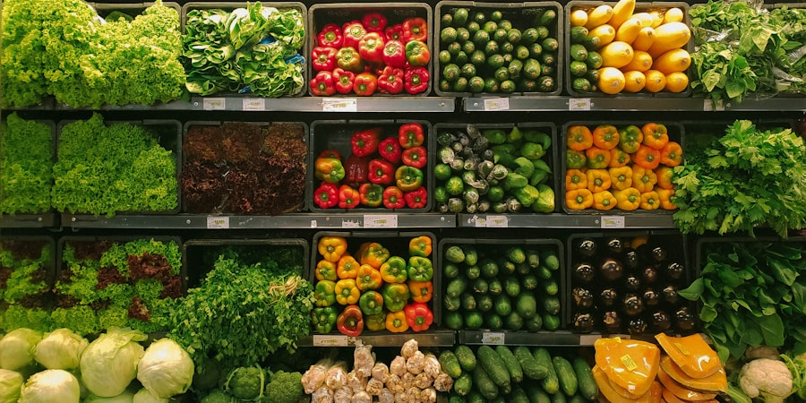

# QuickMart — Zepto-Inspired Grocery Clone

A modern, responsive grocery delivery website built with **HTML**, **CSS**, and **vanilla JavaScript**. Inspired by Zepto's UI/UX but uses original branding ("QuickMart") — no proprietary assets copied.



## Features

### ⚡ Core Storefront & Shopping Experience
- **43 products** across 11 sections, rendered dynamically with high-resolution Unsplash images and local SVG fallbacks
- **15 Category Navigation** — scrollable categories with active highlight and smooth section scrolling
- **Live Product Search & Popular Tags** — real-time keyword search plus one-click keyword pills (Milk, Mango, Rice, Chocolates, Oil, Shampoo)
- **Sorting & Filtering Toolbar**:
  - Filter chips: *All Items*, *Under ₹100*, *Deals (20%+ OFF)*, and *❤️ Wishlist*
  - Sorting options: *Recommended*, *Price: Low to High*, *Price: High to Low*, *Highest Discount*, and *Name (A to Z)*
  - Live product count indicator (*e.g., "Showing 43 items"*)
- **Product Detail Quick-View Modal** — click any product image or title to see high-res photo, freshness highlights, nutrition/category description, synced cart quantity counter, and *"You Might Also Like"* related product recommendations
- **Wishlist / Favorites System** — tap the heart button on any product card to save for later; view and manage in the dedicated Wishlist modal or 1-click *"Add All Wishlist Items to Cart"*

### 🛒 Advanced Cart & Savings System
- **Interactive Cart Sidebar** — smooth slide-in drawer with item quantity controls, subtotal, and dynamic delivery fee calculation
- **Free Delivery Progress Tracker** — live animated progress bar calculating how much more to add to unlock free delivery (threshold: ₹299)
- **Coupons & Promo Codes**:
  - `FIRST20` — 20% OFF (up to ₹100)
  - `QUICK50` — Flat ₹50 OFF on orders ₹399+
  - `FREEDEL` — Free Delivery
  - One-click copy & apply directly from promotional offer cards
  - Real-time coupon discount breakdown and total savings banner (*"🎉 You are saving ₹X on this order!"*)

### 💳 Complete Checkout & Payment Flow
- **Interactive Checkout Modal**:
  - Delivery address review with one-click change
  - Optional rider delivery instructions pills (*"Leave at door"*, *"Don't ring bell"*, *"Avoid calling"*, *"Hand to guard"*)
  - Delivery partner tip selector (None, ₹10, ₹20, ₹30, ₹50)
  - Multiple payment methods: UPI (GPay, PhonePe, Paytm), Credit/Debit Card, Cash on Delivery, QuickMart Wallet
  - Itemized bill breakdown (items total, promo discount, delivery fee, rider tip, ₹2 platform fee, grand total)

### 🛵 Live 10-Minute Order Tracking
- **Real-Time 10:00 Countdown Timer** — live countdown ticking down second by second
- **Simulated Visual Route Graphic** — animated scooter 🛵 moving across the track from Dark Store to your doorstep
- **Live 4-Stage Delivery Stepper**:
  1. Order Placed & Confirmed
  2. Items Being Packed at Store (Dark Store quality check)
  3. Rider Out for Delivery (On the way)
  4. Delivered!
- **Delivery Partner Profile Card** — rider details (Ramesh Kumar, 4.9⭐, Ather 450X) with simulated Call and Message actions
- **Persistent Header Tracking Pill** — pulsing active order indicator in the header allowing users to close and reopen the tracker anytime across page refreshes
- **Order Cancellation** — cancel active orders within the first 2 minutes with instant simulated refund

### 🛍️ Order History ("My Orders") & 1-Click Reorder
- **My Orders Modal** — view past and active orders saved in `localStorage`
- Order ID, date/time, delivery address tag, items summary, payment method, and status badge (*In Transit*, *Delivered*, *Cancelled*)
- **1-Click Reorder All** — instantly add all items from any past order back into your cart

### 📍 Custom Delivery Location Management
- Choose from saved addresses, detect location via GPS, or add custom addresses with house/flat, area, city, pincode, and custom tags (Home/Work/Other)

### 🌓 Dark Mode & User Authentication
- **Dark Mode & Light Mode** toggle with smooth transitions, persistent `localStorage`, and OS theme detection
- **Dedicated Login & Sign Up Page (`login.html`)** — Mobile OTP verification, Email/Password sign-in, account creation, and social logins
- **User Session & Profile State** — dynamic header avatar badge, user dropdown menu, and logout

---

## Project Structure

```text
zepto-clone/
│
├── index.html          # Main storefront page with all modal dialogs
├── login.html          # Dedicated Login & Sign Up page
├── style.css           # Complete responsive CSS (light/dark theme tokens & all components)
├── script.js           # Catalog, cart, checkout, live tracking, wishlist, order history, search & filters
├── login.js            # Authentication logic (OTP, password, registration)
│
├── images/
│   ├── logo.png        # Site logo (QuickMart)
│   ├── banner.jpg      # Hero section grocery delivery banner
│   ├── products/       # Local fallback SVG & JPG product images
│   └── categories/     # Category icon images (SVG)
│
└── README.md
```

## Getting Started

### Option 1: Open directly
Double-click `index.html` in your browser.

### Option 2: Local server (recommended)
```bash
# Using Python
python -m http.server 8080

# Then open http://localhost:8080 in your browser
```

## Available Coupons

| Code | Discount | Minimum Order | Description |
|------|----------|---------------|-------------|
| `FIRST20` | 20% OFF (up to ₹100) | ₹0 | 20% off on your grocery order |
| `QUICK50` | Flat ₹50 OFF | ₹399 | Save ₹50 on orders ₹399 and above |
| `FREEDEL` | Free Delivery | ₹0 | Waives the ₹20 delivery fee |

## Design Tokens

```css
:root {
  --primary: #7b2cbf;
  --secondary: #9d4edd;
  --text: #1a1a24;
  --light: #f1f5f9;
  --border: #e2e8f0;
  --success: #10b981;
  --danger: #ef4444;
}

[data-theme="dark"] {
  --primary: #a855f7;
  --secondary: #c084fc;
  --bg-body: #0b0f19;
  --bg-surface: #111827;
  --bg-card: #1f2937;
  --border: #334155;
}
```

## License

Educational project for learning web development. Not affiliated with Zepto or any grocery brand.

---

© 2026 QuickMart Groceries. All rights reserved.
